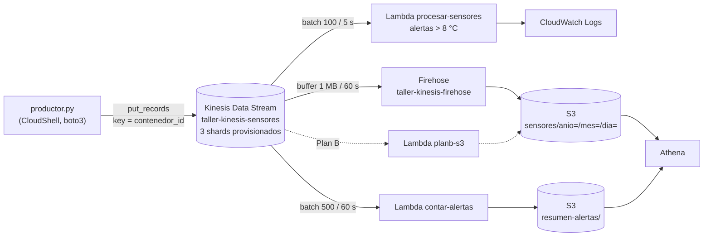

# Informe: pipeline de streaming de sensores con Amazon Kinesis

**Curso:** Big Data e Ingeniería de Datos · **Entorno:** AWS Academy Learner Lab, `us-east-1`, `LabRole`
**Autor(es):** _completar_ · **Fecha:** _completar_

## 1. Arquitectura



El stream es el registro central. Cuatro consumidores independientes leen el mismo flujo: Lambda de alertas, Firehose (o el Plan B) y Lambda de conteo. Todos comparten los 2 MB/s de lectura por shard. Con el volumen del taller sobra capacidad. En producción, con más consumidores, convendría activar *enhanced fan-out*.

## 2. Decisiones de diseño

| Decisión | Elección | Justificación |
|---|---|---|
| Modo de capacidad | **Provisionado** | La carga es estable y conocida (sensores a frecuencia fija). Sale más barato que on-demand en volumen sostenido (sección 4). On-demand se justificaría con tráfico impredecible |
| Partition key | `contenedor_id` | Garantiza orden por contenedor y reparte la carga entre shards. Una key constante crea un *hot shard* (sección 3) |
| Persistencia | Firehose → S3 | Entrega administrada sin código. La latencia de unos 60 s es aceptable para un data lake. El Plan B (Lambda → S3) cubre el caso de que Firehose no esté disponible en el lab |
| Buffer de Firehose | 1 MB / 60 s | El mínimo práctico para ver datos rápido en el taller. En producción convendrían 64–128 MB / 300–900 s para generar menos objetos y más grandes, lo que reduce el costo de S3 y Athena |
| Formato en S3 | JSON Lines, particionado por fecha | Simple y legible para Athena. Mejora posible: conversión a Parquet con Glue Data Catalog |
| Alertas | Lambda sin estado, umbral de 8 °C | Latencia de segundos. Las alertas solo van a logs (posible extensión: SNS) |
| Conteo de alertas | Resúmenes parciales por lote → S3, sumados en Athena | Lambda no guarda estado entre invocaciones. Las claves deterministas (*sequence numbers*) evitan duplicar conteos al reintentar |
| Idempotencia | Claves S3 = `shard-primerSeq-últimoSeq` | La entrega es *al menos una vez*. Un reintento sobrescribe el mismo objeto |

## 3. Análisis de partition key y shards (3 shards)

Procedimiento:
```bash
SHARDS=3 RETO=1 ./scripts/crear_recursos.sh <bucket>
python3 src/productor.py --eventos 1000
python3 src/consumidor.py --tipo AT_TIMESTAMP --minutos 2 --contar
python3 src/productor.py --eventos 1000 --key-constante
python3 src/consumidor.py --tipo AT_TIMESTAMP --minutos 1 --contar
```

| Shard | Key `contenedor_id` | Key constante |
|---|---|---|
| shardId-000000000000 | _n (%)_ | _n (%)_ |
| shardId-000000000001 | _n (%)_ | _n (%)_ |
| shardId-000000000002 | _n (%)_ | _n (%)_ |

Resultado esperado: con `contenedor_id`, los 8 contenedores se reparten entre los 3 shards. El reparto no es exactamente uniforme, porque con solo 8 keys el hash puede dejar 2, 3 y 3 contenedores por shard. Con la key constante, el **100 %** de los registros va a un solo shard: el stream rinde como si tuviera 1 shard, aunque se paguen 3.

_Pegar aquí la salida real del consumidor._

## 4. Estimación de costo

Precios aproximados en `us-east-1`. Hay que verificarlos en https://calculator.aws, porque cambian.

| Concepto | Precio aprox. |
|---|---|
| Shard provisionado | 0,015 USD por shard-hora |
| PUT payload unit (25 KB) | 0,014 USD por millón |
| On-demand | 0,04 USD por stream-hora + 0,08 USD/GB de entrada + 0,04 USD/GB de lectura |
| Firehose | Unos 0,029 USD/GB (cada registro se redondea a múltiplos de 5 KB) |
| Lambda | 0,20 USD por millón de peticiones + cómputo por GB-s |
| S3 / Athena | 0,023 USD por GB-mes / 5 USD por TB escaneado |

**Costo del taller** (3 h, 3 shards, unos 2000 eventos): 3 × 3 × 0,015 ≈ **0,14 USD** en shards. PUT, Firehose, Lambda y S3 suman menos de 0,01 USD. Total: **menos de 0,20 USD**, siempre que se ejecute `scripts/limpieza.sh`. Sin limpieza, el stream sigue costando unos 0,045 USD/h (≈ 32 USD/mes con 3 shards).

**Escenario de producción del enunciado** (5000 sensores × 1 KB/s ≈ 5 MB/s, 13 100 millones de registros/mes):

| | Provisionado (7 shards) | On-demand |
|---|---|---|
| Capacidad | 7 × 730 h × 0,015 ≈ 77 USD | 730 h × 0,04 ≈ 29 USD |
| Ingesta | 13 140 M PUT units × 0,014/M ≈ 184 USD | 13 140 GB × 0,08 ≈ 1051 USD |
| **Total aprox. del stream** | **≈ 261 USD/mes** | **≈ 1080 USD/mes** (más la lectura) |

Con carga sostenida, el provisionado es unas 4 veces más barato. Por eso se eligió ese modo.

## 5. Evidencias

- [ ] Métrica `IncomingRecords` del stream (`docs/evidencias/`)
- [ ] Logs `ALERTA` y `OK` en `/aws/lambda/procesar-sensores`
- [ ] Objetos en `s3://<bucket>/sensores/anio=…/`
- [ ] Consultas de Athena (promedio y alertas por contenedor)
- [ ] Salida de `scripts/limpieza.sh` con todos los recursos vacíos
