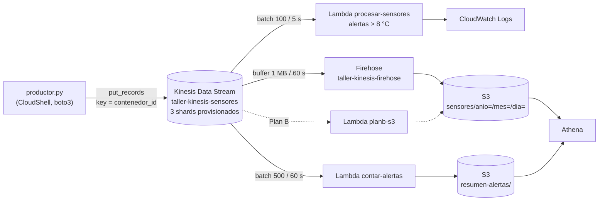

# Informe: pipeline de streaming de sensores con Amazon Kinesis

**Curso:** Big Data e Ingeniería de Datos · **Entorno:** AWS Academy Learner Lab, `us-east-1`, `LabRole`
**Autor(es):** _completar_ · **Fecha:** _completar_

## 1. Arquitectura



El stream es el registro central. Cuatro consumidores independientes leen el mismo flujo: Lambda de alertas, Firehose (o el Plan B) y Lambda de conteo. Todos comparten los 2 MB/s de lectura por shard. Con el volumen del taller sobra capacidad. En producción, con más consumidores, convendría activar *enhanced fan-out*.

## 2. Decisiones de diseño

| Decisión | Elección | Justificación |
|---|---|---|
| Modo de capacidad | **Provisionado** | La carga es estable y conocida (sensores a frecuencia fija). Sale más barato que on-demand en volumen sostenido (sección 4). On-demand se justificaría con tráfico impredecible |
| Partition key | `contenedor_id` | Garantiza orden por contenedor y reparte la carga entre shards. Una key constante crea un *hot shard* (sección 3) |
| Persistencia | Firehose → S3 | Entrega administrada sin código. La latencia de unos 60 s es aceptable para un data lake. El Plan B (Lambda → S3) cubre el caso de que Firehose no esté disponible en el lab |
| Buffer de Firehose | 1 MB / 60 s | El mínimo práctico para ver datos rápido en el taller. En producción convendrían 64–128 MB / 300–900 s para generar menos objetos y más grandes, lo que reduce el costo de S3 y Athena |
| Formato en S3 | JSON Lines, particionado por fecha | Simple y legible para Athena. Mejora posible: conversión a Parquet con Glue Data Catalog |
| Alertas | Lambda sin estado, umbral de 8 °C | Latencia de segundos. Las alertas solo van a logs (posible extensión: SNS) |
| Conteo de alertas | Resúmenes parciales por lote → S3, sumados en Athena | Lambda no guarda estado entre invocaciones. Las claves deterministas (*sequence numbers*) evitan duplicar conteos al reintentar |
| Idempotencia | Claves S3 = `shard-primerSeq-últimoSeq` | La entrega es *al menos una vez*. Un reintento sobrescribe el mismo objeto |

## 3. Análisis de partition key y shards (3 shards)

Procedimiento: en la consola, *Configuración → Editar las particiones aprovisionadas*. Cada cambio solo puede ir entre la mitad y el doble de los shards abiertos, así que se hizo en dos pasos: 1 → 2 → 3. Después:
```bash
python3 src/productor.py --eventos 1000
python3 src/consumidor.py --tipo AT_TIMESTAMP --minutos 2 --contar
# esperar unos 2 minutos para no mezclar los dos envíos
python3 src/productor.py --eventos 1000 --key-constante
python3 src/consumidor.py --tipo AT_TIMESTAMP --minutos 2 --contar
```

| Shard | Estado | Key `contenedor_id` | Key constante |
|---|---|---|---|
| shardId-000000000000 a 002 | Cerrados por el reescalado | 0 | 0 |
| shardId-000000000003 | Abierto | 400 (40,2 %): CT-001, CT-006, CT-007 | **809 (100 %)**: los 8 contenedores |
| shardId-000000000004 y 005 | Cerrados por el reescalado | 0 | 0 |
| shardId-000000000006 | Abierto | 470 (47,2 %): CT-002, CT-004, CT-005, CT-008 | 0 |
| shardId-000000000007 | Abierto | 126 (12,7 %): CT-003 | 0 |
| **Total leído** | | **996** | **809** |

Cada reescalado cierra los shards anteriores y abre otros nuevos. Por eso aparecen 8 shards: 5 cerrados, que siguen listados mientras dura la retención, y 3 abiertos (003, 006 y 007), que son los únicos que reciben datos. El productor reportó 1000 enviados y 0 perdidos en ambos casos. El consumidor leyó menos eventos porque la ventana `AT_TIMESTAMP` de 2 minutos dejó fuera los primeros de cada envío, que dura unos 100 s.

Con `contenedor_id` se usan los 3 shards, pero el reparto no es uniforme: 3, 4 y 1 contenedores, y el shard más cargado recibe el 47 % en lugar del 33 % ideal. Con solo 8 keys, el hash MD5 no tiene suficientes valores para equilibrar los rangos. El orden se mantiene por contenedor. Con la key constante, el **100 %** va al shard 003 y los otros dos quedan ociosos: es un *hot shard*. El stream rinde como 1 shard (1000 registros/s) aunque se paguen 3. Conclusión: la partition key debe tener muchos valores distintos.

Evidencias: `docs/evidencias/22-stream-3-shards.png`, `23-productor-1000.png`, `24-conteo-contenedor-id.png` y `25-conteo-key-constante.png`.

### Segunda Lambda: conteo de alertas por contenedor

`taller-kinesis-contar-alertas` (`lambda/contar_alertas.py`, `LabRole`, timeout de 60 s, `BUCKET=taller-kinesis-asu-2026`) usa su propio trigger sobre el stream: lote 500, ventana 60 s, *Trim horizon* y `ReportBatchItemFailures`. Se probó con dos envíos de 400 eventos. Hubo 3 invocaciones en paralelo por ventana, una por shard abierto, y 6 objetos en `resumen-alertas/` (2 ventanas × 3 shards).

Validación en Athena: los resúmenes de la Lambda (`resumen_alertas`) frente a los eventos crudos de Firehose del mismo día (`sensores WHERE "timestamp" >= '2026-11-02'`):

| Contenedor | Eventos (Lambda / Firehose) | Alertas (Lambda / Firehose) | Temp. máx. |
|---|---|---|---|
| CT-003 | 114 / 114 | 21 / 21 | 12,64 |
| CT-004 | 109 / 109 | 21 / 21 | 15,32 |
| CT-006 | 114 / 114 | 17 / 17 | 11,15 |
| CT-001 | 99 / 99 | 16 / 16 | 13,62 |
| CT-007 | 97 / 97 | 16 / 16 | 11,04 |
| CT-002 | 76 / 76 | 16 / 16 | 12,02 |
| CT-008 | 91 / 91 | 12 / 12 | 11,87 |
| CT-005 | 100 / 100 | 11 / 11 | 11,32 |
| **Total** | **800 / 800** | **130 / 130** | |

Los dos caminos coinciden contenedor por contenedor. Athena escaneó 2,19 KB en `resumen_alertas` frente a 359,37 KB en `sensores`, unas 160 veces menos, porque los datos ya llegan agregados. Evidencias: `docs/evidencias/26` a `34`.

## 4. Estimación de costo

Precios aproximados en `us-east-1`. Hay que verificarlos en https://calculator.aws, porque cambian.

| Concepto | Precio aprox. |
|---|---|
| Shard provisionado | 0,015 USD por shard-hora |
| PUT payload unit (25 KB) | 0,014 USD por millón |
| On-demand | 0,04 USD por stream-hora + 0,08 USD/GB de entrada + 0,04 USD/GB de lectura |
| Firehose | Unos 0,029 USD/GB (cada registro se redondea a múltiplos de 5 KB) |
| Lambda | 0,20 USD por millón de peticiones + cómputo por GB-s |
| S3 / Athena | 0,023 USD por GB-mes / 5 USD por TB escaneado |

**Costo del taller** (3 h, 3 shards, unos 2000 eventos): 3 × 3 × 0,015 ≈ **0,14 USD** en shards. PUT, Firehose, Lambda y S3 suman menos de 0,01 USD. Total: **menos de 0,20 USD**, siempre que se ejecute `scripts/limpieza.sh`. Sin limpieza, el stream sigue costando unos 0,045 USD/h (≈ 32 USD/mes con 3 shards).

**Escenario de producción del enunciado** (5000 sensores × 1 KB/s ≈ 5 MB/s, 13 100 millones de registros/mes):

| | Provisionado (7 shards) | On-demand |
|---|---|---|
| Capacidad | 7 × 730 h × 0,015 ≈ 77 USD | 730 h × 0,04 ≈ 29 USD |
| Ingesta | 13 140 M PUT units × 0,014/M ≈ 184 USD | 13 140 GB × 0,08 ≈ 1051 USD |
| **Total aprox. del stream** | **≈ 261 USD/mes** | **≈ 1080 USD/mes** (más la lectura) |

Con carga sostenida, el provisionado es unas 4 veces más barato. Por eso se eligió ese modo.

## 5. Evidencias

- [x] Métrica `IncomingRecords` del stream (`02-incoming-records.png`)
- [x] Logs `ALERTA` y `OK` en `/aws/lambda/procesar-sensores` (`07`, `08`, `12`)
- [x] Objetos en `s3://taller-kinesis-asu-2026/sensores/anio=…/` (`16`, `17`)
- [x] Consultas de Athena (promedio y alertas por contenedor) (`18` a `21`)
- [x] Reparto por shard con 3 shards (`22` a `25`)
- [x] Segunda Lambda y validación en Athena (`26` a `34`)
- [x] Limpieza: `DROP DATABASE`, salida de `scripts/limpieza.sh` y verificación vacía (`35` a `38`)
